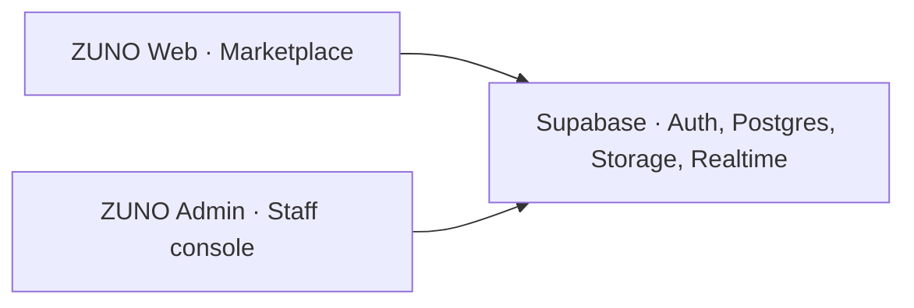

# ZUNO Web

**Buy · Sell · Connect Locally**

ZUNO is a neighborhood marketplace for buying and selling second-hand goods in Uzbekistan and South Korea. Buyers can browse by district, save items, and message sellers to arrange a local meetup.

[Live marketplace](https://zuno-web-wine.vercel.app/) · [ZUNO Admin](https://github.com/olimjon03/zuno-admin)

## Features

- **Local discovery** — country, region, and district filters, category browsing, search, and prices in UZS or KRW.
- **Listing management** — publish listings with photos, optionally mark a location on a map, and manage active, reserved, or sold items.
- **Messaging** — listing-specific conversations with photo and file attachments, unread indicators, and trade updates.
- **Account tools** — saved listings, profiles, buyer and seller feedback, and per-listing statistics.
- **Community and safety** — neighborhood posts, local event feeds, reporting, and blocking.

## Built with

Next.js App Router, React, TypeScript, Tailwind CSS, Supabase (Postgres, Auth, Storage, and Realtime), Leaflet, and Sharp.

The App Router serves the marketplace and account pages. Supabase stores accounts, listings, conversations, and uploaded media. Database migrations in [`supabase/migrations/`](supabase/migrations/) define the schema and access policies. ZUNO Admin uses the same marketplace data through a separate staff application.

## Architecture



Both apps use the same Supabase project. Access to staff tools requires an authorized staff role and multi-factor authentication.

## Run locally

1. Run `npm ci`.
2. Copy [`.env.example`](.env.example) to `.env.local`. Set the Supabase URL and publishable key for a development project. Set the local site URL to `http://localhost:3000`.
3. Apply the SQL migrations in filename order to that development database. Configure OAuth providers and callback URLs for the sign-in options you intend to test.
4. Run `npm run dev` and open [localhost:3000](http://localhost:3000).

The environment template also lists optional settings for account deletion, the assistant, and Turnstile. Keep server secrets out of Git and browser-exposed variables.

## Checks

```sh
npm run lint
npm test
npm run build
```
